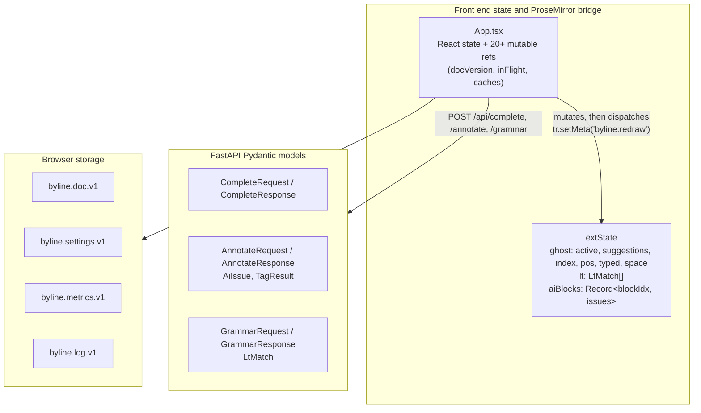
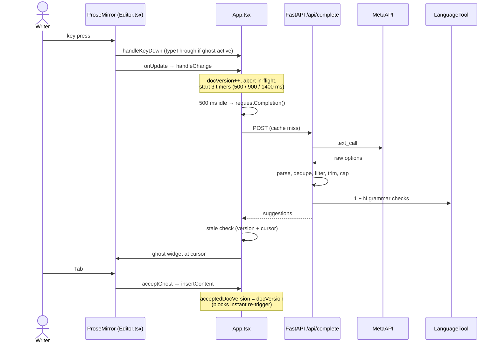
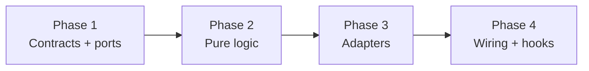

# Byline Architecture Audit

> [!abstract] Summary  
> Byline is a writing editor. It shows **ghost text** (inline AI suggestions), grammar underlines, and AI vocabulary/relevance underlines. A React front end talks to a FastAPI back end. The back end calls an LLM through MetaAPI and calls LanguageTool for grammar checks.
>
> The design is good in four places: the filter pipeline, ID tagging, soft-fail responses, and the loop guard. It has **one confirmed bug** that breaks keyboard use of all popups ([[#Critical bug menuRef is never set]]), plus several smaller defects.

**Legend:** ✔︎ = verified in code. ⚠︎ = defect or technical debt.

## Contents

1. [[#Stage 1 System boundaries and domain map]]
2. [[#Stage 2 Control flow]]
3. [[#Stage 3 Critical code snippets]]
4. [[#Stage 4 Architecture evaluation]]
5. [[#Stage 5 Rewrite guideline]]
6. [[#Stage 6 Checkpoint questions]]

---

## Stage 1 System Boundaries and Domain Map

### 1.1 Entry Points

| Entry point        | Location                                 | What it does                                                                                                                                                                |
| ------------------ | ---------------------------------------- | --------------------------------------------------------------------------------------------------------------------------------------------------------------------------- |
| Browser entry      | `frontend/src/main.tsx:7-14`             | Mounts `<StrictMode><App/></StrictMode>` into `#root`. Loads `theme.css` and `app.css`. ✔︎                                                                                  |
| Editor event hooks | `frontend/src/editor/Editor.tsx:64-101`  | TipTap/ProseMirror hooks: `handleKeyDown`, `handleClick`, `handleDoubleClick`, `onUpdate`, `onBlur`, `onSelectionUpdate`. They forward events to callbacks in `App.tsx`. ✔︎ |
| Back-end entry     | `backend/app/main.py:24-60`              | FastAPI app. Checks the API key at startup. Adds CORS, a 422 validation handler, `GET /`, and 7 `/api` routers. ✔︎                                                          |
| CLI benchmark      | `backend/scripts/token_bench.py:304-320` | `make bench`. Compares legacy JSON output against lean plain-text output (tokens and cost) on MetaAPI. ✔︎                                                                   |
| Sidecar container  | `docker-compose.yml:1-11`                | `erikvl87/languagetool` on `localhost:8010`. ✔︎                                                                                                                             |

### 1.2 The Seven API Routes

| Route | File | Purpose |
|---|---|---|
| `GET /api/health` | `routers/health.py:15` | Checks LanguageTool (`:8010`) and reports LLM config and error state. |
| `POST /api/complete` | `routers/complete.py:76` | Makes and filters the ghost-text continuations. |
| `POST /api/grammar` | `routers/grammar.py:14` | Sends document text to LanguageTool `/v2/check`. |
| `POST /api/annotate` | `routers/annotate.py:15` | Flags vocabulary and relevance issues per paragraph. Uses `[W#]` ID tags. |
| `POST /api/main-idea` | `routers/main_idea.py:14` | Makes a one-sentence "reader takeaway". Runs on manual trigger. |
| `POST /api/synonyms` | `routers/synonyms.py:84` | Makes single-word synonyms. Ranks them with `wordfreq` Zipf score. Filters them with LanguageTool. |
| `POST /api/starter-move` | `routers/starter_move.py:25` | Classifies the rhetorical move (`standard`, `quotation`, `disagreement`, `agreement`, `gap`). Uses it to rank sentence starters. |

### 1.3 Core Domain and Infrastructure

**Rule of thumb:** *Core* code is pure. It has no network, no DOM, no storage. *Infrastructure* code touches the outside world.

#### Back End (`backend/app/`)

| Layer | Files | Content                                                                                                                            |
|---|---|---|
| **Core** | `tokenizer.py` | Sentence/word segmentation. Injects `[S#]`/`[W#]` tags. Resolves consecutive IDs to spans (`first_word_span`, `ids_to_span`).      |
| | `assist.py` | Word caps (Hint 1–5, Phrase 1–8, Sentence 1–25). `trim_overlap`. `join_fragment`. `is_repetitive` (n-gram check). `parse_options`. |
| | `prompts.py` | Prompt assembly. `LEVEL_GUIDE`, `ASSIST_GUIDE`, JSON schemas.                                                                      |
| | `models.py` | Request/response contracts.                                                                                                        |
| **Infrastructure** | `llm.py` | `AsyncOpenAI` singleton pointed at MetaAPI. Cascading `json_call` / `text_call`. Usage and error state.                            |
| | `config.py` | `pydantic-settings` env loader.                                                                                                    |
| | `main.py`, `routers/*.py` | HTTP controllers. Inline `httpx.AsyncClient` calls to LanguageTool. `wordfreq` adapter in `synonyms.py`.                           |

#### Front End (`frontend/src/`)

| Layer | Files | Content |
|---|---|---|
| **Core** | `lib/assist.ts` | Client copy of word caps, `trimOverlap`, `joinFragment`, `needsSpace`. |
| | `lib/ghostLogic.ts` | Type-through state machine (`typeThrough`, `ghostRemainder`). Keys 1–5. Ring buffer of dismissed sets (`saveGhostSet`, `reopenSet`). |
| | `lib/textMap.ts` | Two-way map between the ProseMirror tree and a flat string (`docToText`, `blockTextMap`, `toPmRange`). |
| | `lib/aiBlocks.ts` | Per-block AI issue cache. Re-anchors offsets after a replacement (`removeAiIssueFromBlocks`). |
| | `lib/loopGuard.ts` | Stops accepted AI replacements from being flagged back (`blocksRevert`). |
| | `lib/starters.ts` | 30 rhetorical templates with `[]` blanks. Ranking by move (`rankStarters`). |
| | `lib/cache.ts` | Null-byte key builder. FIFO/LRU `ResultCache<T>`. |
| **Infrastructure** | `lib/api.ts` | `fetch` wrappers with `AbortSignal`. Soft-fail to `null`. |
| | `lib/storage.ts`, `metrics.ts`, `logger.ts` | `localStorage` and Blob export. |
| | `editor/extensionState.ts`, `editor/extensions/*.ts` | Shared mutable state. Decoration plugins (`GhostText`, `LtUnderline`, `AiUnderline`). |
| | `App.tsx`, `editor/Editor.tsx`, `components/*.tsx` | React state, refs, timers, UI. |

### 1.4 Data Models



**Tokenizer span models** (`backend/app/tokenizer.py:26-40`)

- `WordSpan(id, text, start, end, sentence)` maps a word ID such as `"W1"` to its `[start, end)` character slice in the untagged paragraph. It also stores the parent sentence ID (`"S1"`).
- `TagResult(tagged, words, sentences)` holds the tagged string for the LLM (`"[S1] Anxiety [W1] ..."`). It also holds lookup tables for O(1) span rebuild.

**API wire models** (`backend/app/models.py:9-129`)

- `CompleteRequest` carries `context`, `level`, `assist_level`, `before`, `after`, `style_sample`, `version`.
- `CompleteResponse` returns `ok`, `suggestions`, the echoed `version`, `tokens`, `cost`.
- `AiIssue` and `LtMatch` hold character-offset spans. Python field `from_` is aliased to JSON `"from"`.

**ProseMirror mapping and decoration state** (`extensionState.ts:8-31`, `textMap.ts:3-6`, `aiBlocks.ts:4-17`)

- `TextMap { text, map: number[] }` maps flat character index *i* to a ProseMirror position. `-1` marks synthetic `\n\n` block separators.
- `GhostState` stores the suggestion list, selected index, cursor anchor, typed prefix, and a leading-space flag.
- `AiBlocks` is `Record<number, { text, issues }>`. Offsets are block-relative. `collectAiIssues(doc)` turns them into absolute positions at render time.

**Client telemetry and guard models** (`loopGuard.ts:9-14`, `metrics.ts:3-8`, `logger.ts:11-21`)

- `WordDecision { span, replacement, status, ts }` is a ring buffer (max 200) that prevents revert loops.
- `Metrics` and `LogEntry` persist in `localStorage`.

---

## Stage 2 Control Flow

### 2.1 End-to-end Trace: Keystroke → Ghost Text → Tab



### 2.2 Step-by-step

#### Step 1. Key Interception (`Editor.tsx:66-74` → `App.tsx:804-923`)

ProseMirror calls `handleKeyDown` **before** it changes the document.

- `Ctrl/Cmd+Space` forces a completion (`requestCompletion(true)`). With `Shift` it reopens the last ghost set. Both stop the event (`return true`). ✔︎
- Other keys go through `App.handleKey`. It checks layers in this order:
  1. **Starter mode** (`starterActive`): `Tab` jumps to the next `[]` blank (`findNextBlank`). `Escape` exits.
  2. **Menu** (`menuRef`): `Tab`/`Enter` accept. `ArrowUp`/`ArrowDown` move. A printable key closes the menu and lets the character through.
  3. **Ghost** (`extState.ghost.active`):
	 - `Tab` or `1`–`5` call `acceptGhost`.
	 - `Escape` saves the set to `ghostHistory` and dismisses.
	 - Arrows change `g.index` and reset `g.typed`.
	 - A printable non-digit key runs `typeThrough(full, g.typed, key)`. It tests, case-insensitively, whether `full.trimStart()` starts with `(g.typed + key).trimStart()`. On a match, `g.typed` updates and the key passes to ProseMirror. On a mismatch (typo), the set goes to history and the ghost closes. ✔︎

> [!warning] Layer 2 never runs  
> Layer 2 depends on `menuRef.current`. That value is always `null`. See [[#Critical bug menuRef is never set]].

#### Step 2. Document Transaction and Timers (`Editor.tsx:86-101` → `App.tsx:926-947`)

- `onSelectionUpdate` runs first. It checks `selection.from !== g.pos + g.typed.length`. During type-through, `handleKey` has already updated `g.typed`. So the values match and the ghost stays. ✔︎
- `onUpdate` sees `docChanged` and calls `handleChange`:
  - `docVersion.current += 1`.
  - `inFlight.current?.abort()` cancels any pending `/api/complete` request.
  - `saveTimer` (400 ms) writes HTML, context, style sample, and levels to `byline.doc.v1`.
  - `updateNotebook()` runs at once. If the ghost is off and the cursor follows ≥3 ASCII letters, it counts word frequencies in the document and opens the "notebook" popup.
  - Three timers restart: `completeTimer` 500 ms, `grammarTimer` 900 ms, `slowTimer` 1400 ms.

#### Step 3. Client Gate, Cache, Dispatch (`App.tsx:302-370`)

After 500 ms of silence, `requestCompletion(false)` runs. It **stops** if:

- the editor text is blank,
- the cursor is not at the end of the block (unless `force`),
- the notebook menu is open,
- `docVersion === acceptedDocVersion` (the user just accepted a suggestion).

Then it:

1. Reads the text before and after the cursor in the current block.
2. Picks the style sample: user input first, else `styleSampleRef` (last 150 words).
3. Builds the key `[context, level, assist, beforeText, sample].join('\u0000')` and checks the 50-entry LRU.
4. On a miss, creates an `AbortController` and calls `POST /api/complete`.

#### Step 4. Back-end Pipeline (`complete.py:76-149`)

1. **Style gate.** `wants_style_sample()` drops the sample for `Hint` level or for samples under 40 words. This saves about 200 input tokens. ✔︎
2. **LLM call** (`llm.py:181-215`). Model `google/gemini-2.5-flash-lite`, temperature 0.8, `max_tokens` 40 / 60 / 140 (Hint / Phrase / Sentence), timeout 15 s, no `response_format`. Usage and cost go to module global `_last_usage`.
3. **Filters**, in order:

| # | Filter | Rule |
|---|---|---|
| 1 | `parse_options(content, limit=3)` | Strips bullets, numbers, quotes. Recovers from stray JSON. Dedupes without case. |
| 2 | `filter_repetition` | Drops an option if its first 3 words match the first 3 words of any of the last 3 sentences. |
| 3 | `trim_overlap(before, option)` | Matches up to 12 trailing words (or a partial word of ≥2 characters) against the option start. Cuts the overlap. |
| 4 | `filter_by_level` | Keeps only fragments inside the word-count bounds. |
| 5 | `_drop_new_errors` | If `assist_join_grammar_check` is on: 1 + N sequential POSTs to LanguageTool (4 s timeout each). Drops a candidate if any rule ID count rises above the baseline. If LanguageTool is down, keeps all (fail-open). ✔︎ |

#### Step 5. Client Reconciliation (`App.tsx:372-400`)

- The client drops the result if `version !== docVersion.current` or the cursor moved. ✔︎
- It checks `withinCap` again, then fills `extState.ghost` and calls `redraw`.
- The `GhostText` plugin (`GhostText.ts:14-38`) builds `<span class="byline-ghost" aria-hidden="true">` as a `Decoration.widget(pos, el, {side: 1})`.
- React shows `<OptionPopup title="Continue" modal={false}/>` under the cursor. `recordShown` and `logShown` write latency, tokens, and cost to `localStorage`.

#### Step 6. Tab Acceptance (`App.tsx:409-441`)

- `acceptGhost(g.index)` computes `remainder = ghostRemainder(full, g.typed)`. It adds a leading space only if `g.space && !g.typed`.
- It runs `editor.chain().focus().insertContent(insert).run()`. For `Hint` level it then selects the inserted text so the writer can type over it.
- `insertContent` triggers `handleChange`, which schedules a new 500 ms completion. Line 434 sets `acceptedDocVersion.current = docVersion.current`. When the timer fires, line 320 blocks the call. The next completion waits for a manual edit. ✔︎

---

## Stage 3 Critical Code Snippets

### Snippet 1. ID Tagging and Span Resolution

`backend/app/tokenizer.py:42-130`

**Purpose.** An LLM counts characters badly. So the code does not ask for offsets. It inserts `[S#]` and `[W#]` tags into the text. It keeps a lookup table from each `W#` to the exact `[start, end)` range in the original. The LLM returns IDs. The code turns IDs into offsets.

**Side effects.** None. `tag_text` builds a new `TagResult`. `ids_to_span` finds the longest run of consecutive `W` numbers.

```python
def ids_to_span(ids, words):
    spans = [words[i] for i in ids if i in words]
    if not spans:
        return None
    spans.sort(key=lambda s: s.start)

    best_start, best_end = spans[0].start, spans[0].end
    run_start, run_end = best_start, best_end
    prev = _id_number(spans[0].id)
    for span in spans[1:]:
        num = _id_number(span.id)
        if num == prev + 1:
            run_end = span.end          # extend the run
        else:
            run_start, run_end = span.start, span.end   # start a new run
        prev = num
        if (run_end - run_start) > (best_end - best_start):
            best_start, best_end = run_start, run_end
    return best_start, best_end
```

> [!bug] Technical debt
> 1. **ASCII-only words.** `_WORD = [A-Za-z0-9]+(?:['’\-][A-Za-z0-9]+)*`. Words like *naïve*, *café*, *résumé*, and non-Latin scripts split or vanish. They cannot be underlined. ⚠︎
> 2. **Abbreviation splits.** `_SENTENCE = [^.!?\n]+(?:[.!?]+|$)` cuts at every period. "Dr. Smith", "e.g.", "U.S.A." make false sentence tags. ⚠︎
> 3. **Length bias.** `ids_to_span` compares runs by *character length*, not *word count*. One stray 14-letter word (`W9`) beats `W1 W2 W3` = "in a box" (8 characters). ⚠︎

---

### Snippet 2. Subtractive Completion Pipeline

`backend/app/routers/complete.py:60-149`

**Purpose.** The endpoint is a 5-stage filter. The LLM output passes through dedupe, repetition check, overlap trim, length cap, and a LanguageTool differential check.

```python
async def _drop_new_errors(before: str, options: list[str]) -> list[str]:
    if not options:
        return options
    base = last_sentence(before)
    baseline = await _lt_rule_counts(base)
    if baseline is None:      # LT down: keep options, never block the writer
        return options
    kept = []
    for option in options:
        sentence = f"{base} {option}".strip() if base else option   # <-- line 69
        rules = await _lt_rule_counts(sentence)
        if rules is None or not _adds_error(baseline, rules):
            kept.append(option)
    return kept
```

**Side effects.** HTTPS call to MetaAPI. Writes globals `_last_usage` / `_last_error`. Up to 4 sequential POSTs to LanguageTool. One INFO log line.

> [!bug] Technical debt
> 1. **Join spacing.** Line 69 always adds a space. With `before = "the grow"` and fragment `"th of cells"`, LanguageTool checks `"the grow th of cells"`. It flags `th`. The valid partial-word completion is **dropped**. Fix: use `join_text(base, option)` from `assist.py`. ⚠︎
> 2. **Incomplete baseline.** `last_sentence(before)` is often an unfinished clause. It can trigger rule X. A `Hint` or `Phrase` can leave the sentence unfinished and trigger a different rule Y. `_adds_error` then drops a good cue. ⚠︎
> 3. **Sequential calls and fresh clients.** The loop awaits one check at a time. Each check builds and closes a new `httpx.AsyncClient`. Use `asyncio.gather` and one shared client. ⚠︎
> 4. **Usage race.** `get_last_usage()` runs after up to 4 `await` points. Another request can overwrite `_last_usage` meanwhile. ⚠︎

---

### Snippet 3. Cascading JSON Fallback and Global State

`backend/app/llm.py:113-179`

**Purpose.** MetaAPI models differ. Some reject `json_schema` or `json_object`. `json_call` tries three tiers: strict schema, JSON mode, plain call. `_extract_json` then pulls JSON out of the text.

```python
for fmt in formats:                    # json_schema, then json_object
    try:
        resp = await client.chat.completions.create(..., response_format=fmt, ...)
        result = _extract_json(resp.choices[0].message.content or "")
        _record_usage(resp); _set_last_error(None)
        return result
    except Exception as exc:           # catches EVERYTHING
        last_error = exc
        continue
# final attempt without response_format ...
```

**Side effects.** Lazy module-level `_client`. Writes `_last_usage` and `_last_error`. `/api/health` and `/api/complete` read them.

> [!bug] Technical debt
> 1. **Retry on every error.** `except Exception` also catches 401, 429, and timeouts. A bad key or a 15 s timeout fires **3 calls**. Worst case is 3 × 15 s = **45 s**. Retry only on HTTP 400 (format not supported). ⚠︎
> 2. **Greedy bracket slice.** `_extract_json` cuts from the first `{` to the last `}`. For `{"issues": []} Note: use {id}` the slice is not valid JSON. ⚠︎
> 3. **Stale client.** `_get_client()` caches the client once. A changed API key or base URL is ignored. ⚠︎

---

### Snippet 4. Version-stamped Concurrency and Ghost Lifecycle

`frontend/src/App.tsx:302-402`

**Purpose.** Two guards protect a live editor from late responses: an `AbortController` and a pair of checks (monotonic `docVersion` and cursor position). A 50-entry LRU cache avoids repeat calls.

Key lines:

```ts
const posAtRequest = editor.state.selection.from
const version = docVersion.current
const key = cacheKey(contextRef.current, levelRef.current, assist, beforeText, sample)
// ... await requestComplete(...) ...
if (!ed || version !== docVersion.current || ed.state.selection.from !== posAtRequest) return
// ... fill extState.ghost, then:
g.space = needsSpace(beforeText, suggestions[0])
```

**Side effects.** Aborts the previous request. Fills the cache. Mutates `extState.ghost`. Dispatches `byline:redraw`. Updates React state. Appends to `byline.log.v1` and `byline.metrics.v1`.

> [!bug] Technical debt
> 1. **`afterText` is not in the cache key.** After a `Ctrl+Space` mid-paragraph, edit the text after the cursor, then press `Ctrl+Space` at the same prefix. The stale cached result returns. ⚠︎
> 2. **`g.space` uses only option 0.** Arrow keys and number keys never recompute it. If option 0 needs no space and option 1 does, accepting option 1 glues the words together. ⚠︎
> 3. **Style sample goes stale.** `styleSampleRef` refreshes only in `handleReady` and `rerunAll`. The comment on line 286 says "on a commit", but no such refresh exists. A writer who starts from a blank document has an empty sample for the whole session unless they click "Re-run all". ⚠︎

---

### Snippet 5. Per-block AI Decoration Cache and Offset Re-anchoring

`extensionState.ts:33-53` and `lib/aiBlocks.ts:23-41`

**Purpose.** Typing in paragraph *k* must not remove underlines in other paragraphs. Accepting one AI replacement must shift later offsets in the same paragraph by `delta`. No new LLM call is needed.

```ts
// extensionState.ts
export function collectAiIssues(doc: PMNode): AiIssueAt[] {
  const out: AiIssueAt[] = []
  doc.forEach((node, offset, index) => {
    const cache = extState.aiBlocks[index]
    if (!cache || cache.text !== node.textContent) return   // skip stale blocks
    const { map } = blockTextMap(doc, offset)
    for (const issue of cache.issues) {
      const r = toPmRange(map, issue.from, issue.to)
      if (r) out.push({ ...issue, from: r.from, to: r.to,
                        blockIndex: index, relFrom: issue.from, relTo: issue.to })
    }
  })
  return out
}
```

```ts
// lib/aiBlocks.ts
export function removeAiIssueFromBlocks(blocks, issue, replacement) {
  const cache = blocks[issue.blockIndex]
  if (!cache) return blocks
  const delta = replacement.length - (issue.relTo - issue.relFrom)
  const issues = cache.issues
    .filter((i) => !(i.from === issue.relFrom && i.to === issue.relTo))
    .map((i) => {
      if (i.from >= issue.relTo) return { ...i, from: i.from + delta, to: i.to + delta }
      if (i.to <= issue.relFrom) return i
      return null                       // overlapping issue: drop
    })
    .filter((i): i is AiIssue => i !== null)
  const text = cache.text.slice(0, issue.relFrom) + replacement + cache.text.slice(issue.relTo)
  return { ...blocks, [issue.blockIndex]: { text, issues } }
}
```

**Side effects.** `removeAiIssueFromBlocks` is pure. `collectAiIssues` runs on **every** transaction inside `AiUnderline.decorations(state)`.

> [!bug] Technical debt
> 1. **Index keys drift.** `aiBlocks` uses the child index as key. Press Enter at the top of the document and every later paragraph moves by +1. Each lookup compares the wrong paragraph text. **All AI underlines below the new line vanish.** Key by content hash, or map through `tr.mapping`. ⚠︎
> 2. **No staleness check on grammar/AI requests** (`App.tsx:470-525`). `requestGrammarCheck` and `requestAiCheck` have no `docVersion` check and no `AbortController`. The result is mapped with the `map` taken *before* the `await` and applied to the *new* document. Underlines land on the wrong characters until the next check. ⚠︎

---

## Stage 4 Architecture Evaluation

### 4.1 Patterns that Work

| Pattern | Where | Benefit |
|---|---|---|
| **Subtractive pipe-and-filter** | `complete.py`, `assist.py` | Pure, testable filters enforce word caps, no prefix repeat, and grammar safety. They hold even if the model ignores the prompt. ✔︎ |
| **ID tagging (symbolic indirection)** | `tokenizer.py`, `annotate.py` | The LLM returns `[W#]` IDs. The code resolves spans. No off-by-one offsets. Stray IDs (`W1`, `W15`) cannot underline a whole paragraph. ✔︎ |
| **Soft-fail envelope, fail-open** | `models.py`, `api.ts` | Endpoints return HTTP 200 with `{"ok": false}` on upstream failure. LanguageTool timeouts skip the filter. The writer never sees an error modal. ✔︎ |
| **Loop guard** | `loopGuard.ts` | A bounded history of accepted `(span, replacement)` pairs blocks ping-pong flags between two synonyms. ✔︎ |
| **Hybrid LLM calling** | `llm.py`, `token_bench.py` | Plain text with small `max_tokens` for flat output. JSON only for multi-field output. The benchmark shows 14%–50% fewer tokens and no schema retry cascades. ✔︎ |

### 4.2 Anti-patterns

#### God Component: `App.tsx` (1,269 lines)

It holds 12 `useState`, 22 `useRef`, 4 timers, ProseMirror helpers (`wordAtPos`, `findNextBlank`), key routing, network code, caching, telemetry, and about 260 lines of JSX/SVG.

**Risk.** High mental load. Fragile closures in `useCallback`. Hard to test without mounting the whole app.

#### Critical Bug: `menuRef` is Never Set

> [!danger] Confirmed defect  
> `menuRef` is created at `App.tsx:214` with `useRef<MenuState | null>(null)`. Code reads it at lines 317, 540, 544, 557, and 820. **No code ever assigns `menuRef.current`.** `openMenu` and `closeMenu` call `setMenu` only.
>
> **Effects:**
> - `handleKey` line 820 (`const m = menuRef.current; if (m) {...}`) never runs. Keyboard control (`Tab`, `Enter`, `Escape`, arrows) is **dead** for all four popups: fix, synonym, starter, notebook.
> - `requestCompletion` and `updateNotebook` never see an open notebook menu.
> 
> **Fix:** assign `menuRef.current = menu` in an effect, or move menu and ghost state into one reducer (see [[#Phase 2 Core business logic]]).

#### Module-global Mutable Singletons

- **Back end.** `_last_error` and `_last_usage` in `llm.py:25-65` are shared by all requests. Request A can read Request B's token count.
- **Front end.** `extState` is a module global. Two `<Editor/>` instances cannot coexist. Tests need manual resets (`tests/repro.test.tsx`).

#### Cross-stack Duplication

`ASSIST_CAPS`, `wordCount`, `withinCap`, `trimOverlap`, `joinFragment`, `joinText` exist in both Python and TypeScript. The back end already runs `trim_overlap` (`complete.py:123`). The front end then runs `trimOverlap` again inside `needsSpace` (`App.tsx:391`) on the trimmed text.

**Example.** `before = "the grow"`, LLM returns `"growth of cells"`.  
Back end returns `"th of cells"`. Front end checks `"th".startsWith("grow")`, gets `false`, and returns `true` (space needed). Tab inserts `" th of cells"`. Result: `the grow th of cells`. ⚠︎

#### ProseMirror Plugin State is Bypassed

`LtUnderline`, `AiUnderline`, and `GhostText` read from external `extState` and rebuild `DecorationSet.create(...)` on every keystroke. They do not store decorations in `PluginSpec.state` and do not map through `tr.mapping`. For up to 900 ms after typing, red underlines drift off their words.

### 4.3 Resilience Gaps

| Gap | Location | Problem |
|---|---|---|
| Retry cascade | `llm.py:143-178` | Retries on any error. Should fail fast on timeout, 401/403, 429. |
| Connection churn | `complete.py:44`, `grammar.py:20`, `synonyms.py:58`, `health.py:19` | New `httpx.AsyncClient` per call. No keep-alive. `/complete` (up to 4 calls) and `/synonyms` (up to 9) run in a `for` loop, not `asyncio.gather`. |
| Prompt injection | `prompts.py:116-237` | User text goes into f-strings under headers like `CONTEXT:` and `TASK:`. A draft that contains `\n\nTASK: Ignore previous instructions...` can change the instructions. No XML/delimiter tags. No length limits on Pydantic fields. |
| Hot-path storage | `logger.ts:37-45`, `metrics.ts:30-44` | Each `logShown` parses and re-serializes the whole 1,000-entry JSON array. It runs 3–5 times in one `.forEach` (`App.tsx:397, 575, 646, 763`) on the UI thread. |

---

## Stage 5 Rewrite Guideline

The plan has four phases. Each phase depends only on the earlier ones.

### Phase 1 Core Domain Models and Interfaces

*(no external dependencies)*

1. **Canonical contracts** in `backend/app/domain/models.py` and `frontend/src/domain/types.ts`.
   - Immutable value objects: `WordSpan`, `TaggedDocument`, `ContinuationCandidate`, `AnnotationIssue`, `GrammarMatch`, `TokenUsage`.
   - Interface ports: `LLMClientPort`, `GrammarCheckerPort`, `WordFrequencyPort`, `TelemetryStorePort`.
2. **One offset contract.** The back end returns  
   `ContinuationItem { full_text, insert_fragment, needs_leading_space }`.  
   Overlap and join math then runs **once**, in one place.

### Phase 2 Core Business Logic

*(pure functions, deterministic state machines)*

1. **Unicode-aware tokenizer** (`domain/tokenizer.py`). Use `\w+` with smart-quote and hyphen support. Use abbreviation-safe sentence splitting. Rank `[W#]` runs by word count first, character length second.
2. **Pure completion pipeline** (`domain/assist_pipeline.py`). Contains `parse_options`, `filter_repetition`, `compute_join(before, option)` (returns the spaced sentence for grammar checks *and* the exact insert slice), and `filter_by_level`.
3. **Editor state reducers** (`frontend/src/domain/editorMachine.ts`). One reducer holds `GhostState`, `MenuState`, the loop guard, and `AiBlockCache`. This fixes the `menuRef` bug. The AI cache uses a content hash plus position mapping, not an integer index.

### Phase 3 Infrastructure Adapters

*(I/O, SDKs, ProseMirror plugins)*

1. **MetaAPI adapter** (`adapters/MetaAPI_llm.py`). Wrap `AsyncOpenAI` in a class. Return `(result, TokenUsage)` on the call stack. No global `_last_usage`. Retry the format fallback only on HTTP 400 / "schema unsupported".
2. **Pooled LanguageTool adapter** (`adapters/languagetool.py`). One shared `httpx.AsyncClient` from the FastAPI lifespan. `check_candidates_concurrently(base, joined_candidates)` uses `asyncio.gather`.
3. **Transaction-mapped plugins** (`editor/plugins/`). Keep the `DecorationSet` in plugin state:  
   `apply(tr, set) { return set.map(tr.mapping, tr.doc) }`. Underlines then follow the text while a re-check is pending.
4. **Batched storage adapter** (`adapters/localStorageAdapter.ts`). Buffer `LogEntry` and `Metrics` in memory. Flush through `requestIdleCallback` or one debounced write.

### Phase 4 Integration and Wiring

*(explicit dependency injection)*

1. **Back-end composition root** (`main.py`). Build `MetaAPILLMAdapter` and `LanguageToolAdapter(httpx_client)` in `lifespan(app)`. Store them on `app.state`. Inject with `Depends(get_llm_service)` and `Depends(get_grammar_service)`.
2. **Front-end hook split** (`frontend/src/hooks/`). Extract `useGhostCompletion`, `useDocumentAnnotations`, `useOptionMenu`, `useStarterBlanks`. `App.tsx` becomes a thin layout shell under 200 lines.



---

## Stage 6 Checkpoint Questions

Try each question first. The answers are folded.

### Q1. Partial-word Join Failure

**Setup.** `before = "The study examines the grow"`. The LLM returns `"growth of cells"`.

1. What does `trim_overlap(req.before, option)` return in `suggestions[0]`?
2. What exact string does `_drop_new_errors` send to LanguageTool, and why?
3. If LanguageTool is offline, what does `needsSpace(beforeText, suggestions[0])` return, and what text does Tab insert?

> [!success]- Answer
> 1. **`"th of cells"`.** The trailing partial word `grow` (≥2 characters) matches the start of the option. The function cuts it.
> 2. **`"The study examines the grow th of cells"`.** Line 69 always joins with one space (`f"{base} {option}"`). LanguageTool sees `th` as a separate misspelled word. The valid option is dropped. `join_text(base, option)` would give `"...the growth of cells"`.
> 3. **`needsSpace` returns `true`.** It runs `trimOverlap` again. `"th of cells".startsWith("grow")` is `false`, so no overlap is found and a space is judged necessary. `g.space = true` and `g.typed` is empty, so Tab inserts **`" th of cells"`**. The document reads `The study examines the grow th of cells`.

### Q2. Popup Keyboard Routing

**Setup.** The user clicks a red LanguageTool underline. `openFixMenu` (`App.tsx:579`) shows the "Fix" popup. The user presses `ArrowDown`, then `Tab` or `Enter`.

1. Why does `handleKey` not catch these keys?
2. Which handler gets them, and what happens to the document?

> [!success]- Answer
> 1. `menuRef.current` is **always `null`**. Nothing assigns it when `setMenu` runs. So `if (m) { ... }` at line 820 is skipped.
> 2. `handleKey` continues to the ghost branch. The ghost is normally not active, so it returns `false`. **ProseMirror and the browser handle the keys.**
>    - `ArrowDown` moves the text cursor down. The popup selection does not change.
>    - `Enter` runs the editor's default: it **splits the paragraph** at the cursor. The suggested fix is not applied.
>    - `Tab` has no editor action here (unless an extension binds it). By default the browser moves focus out of the editor. *This part depends on the TipTap extensions in use, which the audit does not list.*

### Q3. Coordinate Mapping and Structural Drift

**Setup.** Paragraph 0 is `"First paragraph."`. Paragraph 1 is `"Anxiety affects cognitive functioning."`. `/api/annotate` cached a vocabulary issue on "cognitive" in `extState.aiBlocks[1]`.

1. Why does `blockTextMap` (`textMap.ts:48`) use `blockPos + 1 + pos + i`?
2. The user puts the cursor at the very start of Paragraph 0 and presses Enter. What does `collectAiIssues` do on the next render? Why do the purple underlines vanish?

> [!success]- Answer
> 1. A top-level block node has an **opening token**. `blockPos` is the position *before* the block. The first character of its content sits at `blockPos + 1`. Without the `+ 1`, every underline would be off by one.
> 2. Enter at the start splits Paragraph 0 into an empty block and `"First paragraph."`. The document now has 3 blocks:
> 
> | Index | Text | `aiBlocks[index]` |  
> |---|---|---|  
> | 0 | *(empty)* | none |  
> | 1 | `First paragraph.` | cached text is `"Anxiety affects..."` → **mismatch** |  
> | 2 | `Anxiety affects cognitive functioning.` | **none** (cache is still at key 1) |
>
> For index 1, `cache.text !== node.textContent`, so the function returns. For index 2, there is no cache entry, so it returns. No issues are collected and the underlines vanish. They return only after the next `/api/annotate` response (the 1400 ms `slowTimer`) fills the cache under the new index.

---

## Fix Priority

| #   | Fix                                                                      | Effort  | Reason                                                 |
| --- | ------------------------------------------------------------------------ | ------- | ------------------------------------------------------ |
| 1   | Assign `menuRef.current`                                                 | Minutes | Restores keyboard control for all popups.              |
| 2   | Use `join_text` in `_drop_new_errors`; stop the double `trimOverlap`     | Small   | Stops dropped and mis-spaced partial-word completions. |
| 3   | Add `docVersion` checks and `AbortController` to grammar and AI requests | Small   | Stops underlines landing on wrong text.                |
| 4   | Retry `json_call` only on HTTP 400                                       | Small   | Cuts worst-case latency from 45 s to 15 s.             |
| 5   | Key `aiBlocks` by content hash                                           | Medium  | Keeps underlines when the user inserts paragraphs.     |
| 6   | Map decorations through `tr.mapping`                                     | Medium  | Stops underline drift.                                 |
| 7   | Split `App.tsx` into hooks                                               | Large   | Makes everything above easier to test.                 |
